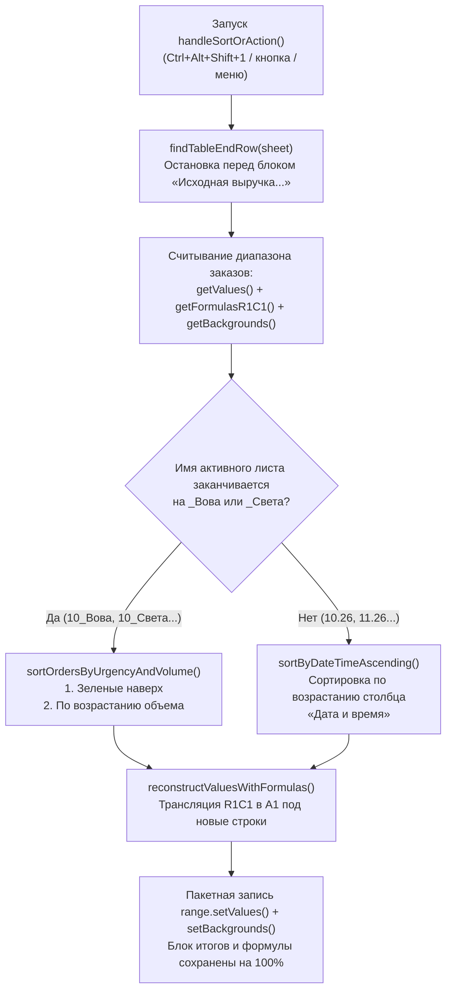

# Сортировка заказов и контекстный диспетчер (Google Apps Script)

Модуль контекстной автоматической сортировки рабочих таблиц заказов для **Google Sheets** на базе облачного JavaScript (Google Apps Script).

---

## 1. Техническое задание (ТЗ)

### 1.1. Назначение и контекст
В рабочей книге сосуществуют два принципиально разных типа листов:
1. **Персональные листы исполнителей (`*_Вова`, `*_Света`, например `10_Вова`, `10_Света`, `11_Вова`):** рабочие очереди исполнителей, где критически важна срочность (цветовое выделение) и распределение нагрузки по объемам.
2. **Общие листы книги (`10.26`, `11.26`, `Сводные данные`, субподряд и др.):** сводные реестры заказов, где ключевым критерием является хронология сдачи проектов заказчикам. Внизу этих листов расположены блоки финансовых итогов и курсов валют (`Q42:Q50` и сводные строки).

**Цель:** Реализовать единый макрос (одна горячая клавиша или одна кнопка), который автоматически определяет тип текущего активного листа и применяет к нему нужный алгоритм сортировки, гарантируя 100% сохранность формул и изоляцию блока итогов.

### 1.2. Требования к режимам сортировки:

#### Режим 1: Персональные листы (`*_Вова`, `*_Света`)
1. **Уровень 1 (Приоритет срочности):** Строки с зеленой заливкой ячейки в столбце A («Номер заказа») поднимаются на самый верх таблицы. Распознаются как стандартный Excel-зеленый (`#92D050`), так и оттенки зеленого из палитры Google Таблиц.
2. **Уровень 2 (Группировка по объему):** Внутри группы срочных и внутри группы обычных заказов строки сортируются по возрастанию объема (столбец B, от меньшего к большему).
3. **Пустые строки:** Смещаются в самый низ рабочей области заказов.

#### Режим 2: Все остальные листы (`10.26`, `11.26` и др.)
1. **Динамический поиск столбца с дедлайном:** Скрипт анализирует первую строку таблицы и находит столбец с заголовком «Дата и время» / «Дата и время сдачи» (по умолчанию столбец C).
2. **Хронологическая сортировка:** Строки сортируются по возрастанию даты и времени (от более ранних дедлайнов к более поздним) с точностью до минут. Поддерживаются нативные даты Google Sheets и строковые даты вида `31.10.2026 00:00`.
3. **Пустые строки:** Строки без номера заказа или без даты смещаются в самый низ рабочей области заказов.

### 1.3. Критические требования к целостности формул и изоляции данных:
- **Сохранение и адаптация формул (R1C1 $\rightarrow$ A1):** Скрипт считывает формулы методом `getFormulasR1C1()` и при перезаписи строк транслирует относительные смещения (`RC[-3]`) в новые абсолютные координаты строк (`r1c1ToA1`), полностью сохраняя формулы пересчета валют и сумм (столбцы `K`, `L`, `M`, `N`) и абсолютные ссылки на курсы валют (`$Q$42`). Значения без формул сохраняются как обычные данные.
- **Изоляция сводного блока и курсов (`findTableEndRow`):** Запрещено использовать слепой `sheet.getLastRow()`. Скрипт динамически сканирует строки и останавливает границу диапазона сортировки строго перед маркерами сводки («Исходная выручка в каждой валюте», «Прибыль за месяц», «Соотношение валют» и др.). Блок курсов и итогов никогда не попадает в сортировку.
- **Сохранение валидации и стилей:** Полное сохранение выпадающих списков (Data Validation), цветов заливки (включая синие, зеленые и пользовательские цвета), начертания шрифта (жирный/обычный) и цветов текста.
- **Производительность:** Пакетное считывание и запись за один такт со временем выполнения $\le 300$ мс.

---

## 2. Описание функционала и архитектура

| Файл | Описание |
| :--- | :--- |
| `order-sorting.js` | Единый скрипт Google Apps Script (v1.3.0). Включает точку входа `handleSortOrAction()`, контекстные сортировщики `sortOrdersByUrgencyAndVolume()` и `sortByDateTimeAscending()`, детектор границы `findTableEndRow()`, транслятор формул `r1c1ToA1()` и триггер меню `onOpen()`. |

### Схема работы алгоритма:

---

## 3. Инструкция по установке

1. Откройте Google Таблицу в браузере.
2. В верхнем меню выберите: **Расширения** $\rightarrow$ **Apps Script**.
3. Замените весь код содержимым файла [`order-sorting.js`](order-sorting.js) и нажмите **Сохранить** (`Ctrl + S`).
4. Обновите вкладку таблицы (`F5`). В верхнем меню появится пункт **`⚡ Автоматизация` $\rightarrow$ `Сортировать (авто-режим листа)`**.

---

## 4. Инструкция по привязке горячих клавиш

Для назначения комбинации клавиш **`Ctrl + Alt + Shift + 1`** на единую точку входа:

1. В меню Google Таблицы откройте: **Расширения** $\rightarrow$ **Макросы** $\rightarrow$ **Импортировать макрос**.
2. В списке функций найдите **`handleSortOrAction`** и нажмите **Добавить функцию**.
3. Откройте: **Расширения** $\rightarrow$ **Макросы** $\rightarrow$ **Настроить макросы**.
4. Напротив функции `handleSortOrAction` введите цифру **`1`** (комбинация автоматически станет `Ctrl + Alt + Shift + 1`).
5. Нажмите **Сохранить**.

---

## 5. Как навсегда пройти окно «Требуется авторизация»

При первом запуске нового скрипта Google Sheets выдает разовое окно безопасности:

### Разовое решение (15 секунд):
1. Откройте: **Расширения** $\rightarrow$ **Apps Script**.
2. На панели инструментов сверху в выпадающем списке выберите функцию **`handleSortOrAction`**.
3. Нажмите кнопку **Выполнить** (значок `▷`).
4. В появившемся окне авторизации:
   - Выберите свой Google-аккаунт.
   - На предупреждении *«Google не проверил это приложение»* нажмите **Дополнительные настройки** (*Advanced*).
   - Внизу нажмите **Перейти на страницу "..." (небезопасно)** (*Go to ... (unsafe)*).
   - Нажмите **Разрешить** (*Allow*).
5. Дождитесь надписи `Выполнение завершено` внизу редактора.

После этого окно больше никогда не появится ни при вызове с клавиатуры, ни по кнопке на листе.
