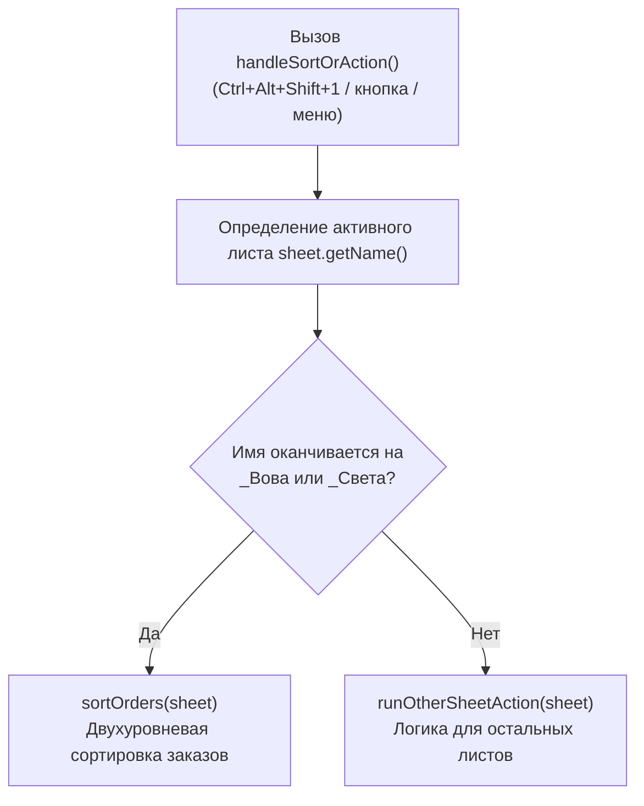

# Сортировка заказов и контекстный диспетчер (Google Apps Script)

Модуль двухуровневой сортировки рабочих таблиц заказов с **контекстной маршрутизацией по имени листа** для **Google Sheets**.

---

## 1. Техническое задание (ТЗ) и логика маршрутизации

### 1.1. Контекстная диспетчеризация по имени активного листа
В книге сосуществуют персональные листы исполнителей (`*_Вова`, `*_Света`, например `10_Вова`, `10_Света`, `11_Вова`) и общие листы (сводные, архивы, субподряд и др.).
Пользователю требуется использовать **одну и ту же комбинацию клавиш** (или кнопку):
- **Если активен лист, оканчивающийся на `_Вова` или `_Света`:** выполняется двухуровневая сортировка заказов.
- **Если активен любой другой лист:** управление передается функции `runOtherSheetAction()`, где выполняется соответствующее действие для других листов.

### 1.2. Требования к сортировке заказов:
1. **Уровень 1 (Приоритет срочности):** Строки с зеленой заливкой ячейки в столбце A поднимаются наверх (распознаются `#92D050` и оттенки палитры Google Sheets).
2. **Уровень 2 (По возрастанию объема):** Внутри каждой группы (зеленые / обычные) строки сортируются по возрастанию объема (столбец B).
3. **Пустые строки:** Смещаются в самый низ таблицы.
4. **Сохранение метаданных:** Выпадающие списки (Data Validation), жирный шрифт и цвета сохраняются без изменений.

---

## 2. Архитектура решения

Точкой входа является функция **`handleSortOrAction()`**:

---

## 3. Инструкция по установке и настройке

1. В Google Таблице откройте: **Расширения** $\rightarrow$ **Apps Script**.
2. Замените код содержимым файла [`order-sorting.js`](order-sorting.js) и нажмите `Ctrl + S`.
3. В функцию **`runOtherSheetAction(sheet)`** добавьте или вызовите нужный код для остальных листов.
4. Привязка к горячей клавише:
   - **Расширения** $\rightarrow$ **Макросы** $\rightarrow$ **Импортировать макрос**.
   - Добавьте функцию **`handleSortOrAction`**.
   - В **Настроить макросы** назначьте ей цифру `1` (`Ctrl + Alt + Shift + 1`).

Теперь по `Ctrl + Alt + Shift + 1`:
- На листах `10_Вова` и `10_Света` мгновенно отсортируются заказы;
- На остальных листах отработает ваш второй скрипт.
