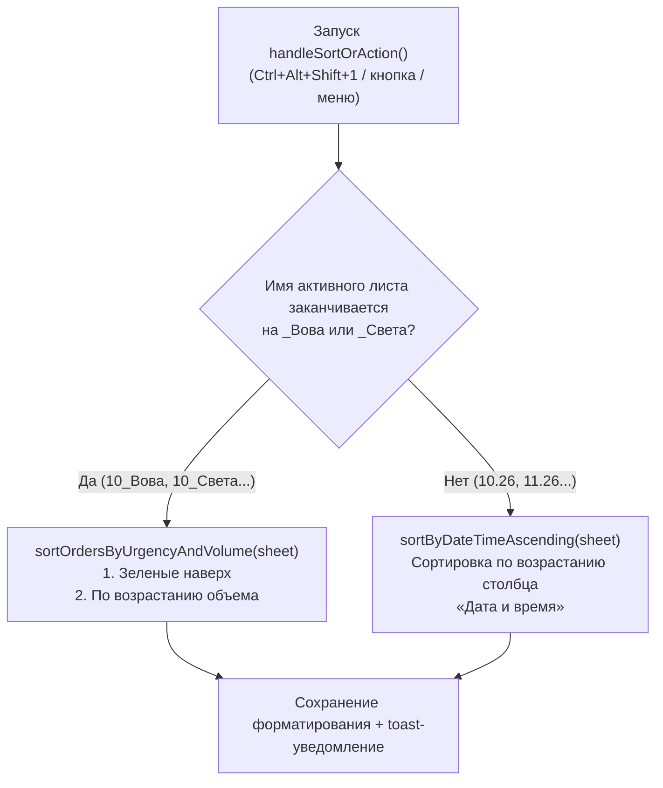

# Сортировка заказов и контекстный диспетчер (Google Apps Script)

Модуль контекстной автоматической сортировки рабочих таблиц заказов для **Google Sheets** на базе облачного JavaScript (Google Apps Script).

---

## 1. Техническое задание (ТЗ)

### 1.1. Назначение и контекст
В рабочей книге сосуществуют два принципиально разных типа листов:
1. **Персональные листы исполнителей (`*_Вова`, `*_Света`, например `10_Вова`, `10_Света`, `11_Вова`):** рабочие очереди исполнителей, где критически важна срочность (цветовое выделение) и распределение нагрузки по объемам.
2. **Общие листы книги (`10.26`, `11.26`, `Сводные данные`, субподряд и др.):** сводные реестры заказов, где ключевым критерием является хронология сдачи проектов заказчикам.

**Цель:** Реализовать единый макрос (одна горячая клавиша или одна кнопка), который автоматически определяет тип текущего активного листа и применяет к нему нужный алгоритм сортировки.

### 1.2. Требования к режимам сортировки:

#### Режим 1: Персональные листы (`*_Вова`, `*_Света`)
1. **Уровень 1 (Приоритет срочности):** Строки с зеленой заливкой ячейки в столбце A («Номер заказа») поднимаются на самый верх таблицы. Распознаются как стандартный Excel-зеленый (`#92D050`), так и оттенки зеленого из палитры Google Таблиц.
2. **Уровень 2 (Группировка по объему):** Внутри группы срочных и внутри группы обычных заказов строки сортируются по возрастанию объема (столбец B, от меньшего к большему).
3. **Пустые строки:** Смещаются в самый низ таблицы.

#### Режим 2: Все остальные листы (`10.26`, `11.26` и др.)
1. **Динамический поиск столбца с дедлайном:** Скрипт анализирует первую строку таблицы и находит столбец с заголовком «Дата и время» / «Дата и время сдачи» (по умолчанию столбец C).
2. **Хронологическая сортировка:** Строки сортируются по возрастанию даты и времени (от более ранних дедлайнов к более поздним) с точностью до минут. Поддерживаются нативные даты Google Sheets и строковые даты вида `31.10.2026 00:00`.
3. **Пустые строки:** Строки без номера заказа или без даты смещаются в самый низ.

### 1.3. Требования к сохранению данных:
- Полное сохранение выпадающих списков (Data Validation: «Тип работы», «Сложность» и т.д.).
- Сохранение форматирования ячеек: цвета заливки (включая синие, зеленые и пользовательские цвета), начертание шрифта (жирный/обычный) и цвета текста.
- Пакетное считывание и запись (`getValues`/`setValues`) за один такт со временем выполнения $\le 300$ мс.

---

## 2. Описание функционала и архитектура

| Файл | Описание |
| :--- | :--- |
| `order-sorting.js` | Единый скрипт Google Apps Script. Включает точку входа `handleSortOrAction()`, сортировку исполнителей `sortOrdersByUrgencyAndVolume()`, хронологическую сортировку `sortByDateTimeAscending()`, вспомогательные парсеры и триггер меню `onOpen()`. |

### Схема диспетчеризации:

---

## 3. Инструкция по привязке горячих клавиш

Для назначения комбинации клавиш **`Ctrl + Alt + Shift + 1`** на единую точку входа:

1. В меню Google Таблицы откройте: **Расширения** $\rightarrow$ **Макросы** $\rightarrow$ **Импортировать макрос**.
2. В списке функций найдите **`handleSortOrAction`** и нажмите **Добавить функцию**.
3. Откройте: **Расширения** $\rightarrow$ **Макросы** $\rightarrow$ **Настроить макросы**.
4. Напротив функции `handleSortOrAction` введите цифру **`1`** (комбинация автоматически станет `Ctrl + Alt + Shift + 1`).
5. Нажмите **Сохранить**.

---

## 4. Как навсегда пройти окно «Требуется авторизация»

При первом запуске нового скрипта Google Sheets выдает разовое окно безопасности:

### Разовое решение (15 секунд):
1. Откройте: **Расширения** $\rightarrow$ **Apps Script**.
2. На панели инструментов сверху в выпадающем списке выберите функцию **`handleSortOrAction`**.
3. Нажмите кнопку **Выполнить** (значок `▷`).
4. В появившемся окне авторизации:
   - Выберите свой Google-аккаунт.
   - На предупреждении *«Google не проверил это приложение»* нажмите **Дополнительные настройки** (*Advanced*).
   - Внизу нажмите **Перейти на страницу "..." (небезопасно)** (*Go to ... (unsafe)*).
   - Нажмите **Разрешить** (*Allow*).
5. Дождитесь надписи `Выполнение завершено` внизу редактора.

После этого окно больше никогда не появится ни при вызове с клавиатуры, ни по кнопке на листе.
